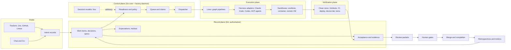

# Waymark as a software factory

Proposal, 2026-10-23. This plan describes the end state if Waymark grows from a project-context CLI into a full software factory. It deliberately looks past the current milestone and the vision's deferral of agent execution. The [vision revisions](#what-this-changes-in-the-vision) section lists every commitment it would change. Nothing here is adopted until those revisions are decided.

Inputs:
- The [software factory research note](../.scratch/workflow-improvements/software-factory-research.md), which covers StrongDM's Attractor and factory site, Fabro, Lightspeed, Superplane, Open-Inspect, CodeAF, and SWE-AF.
- Local decision-model trials run on 2026-10-22 and 2026-10-23 (Laya, Kev, and Qwen 3.5 through Ollama).

## The bet

Every factory we examined is an agent runtime with weak evidence:
- Stages report their own success.
- Merged pull requests count as done.
- Criteria get written, or relaxed, by the agents being judged.
- Fabro's own examples contain test gates that cannot fail.

None of them keeps durable, revision-aware project records, so none of them can say what was intended, what was checked, and whether that check still holds.

That missing half is what Waymark already does:
- Context assembly with digests and inclusion reasons.
- Deterministic readiness.
- Acceptance records that fingerprint the requirements they judged.
- Evidence that keeps its origin and tested revision.

The factory is the other half: an execution, verification, and review loop that writes into those records instead of around them.

**Waymark Factory takes intent to merged, verified change. Every step leaves a record a human can audit, and autonomy is earned per class of work from that record.**

## North star

The vision's Wi-Fi scenario, run end to end by the factory:

1. A product owner files "enable Wi-Fi on the device" in Jira. The factory imports it as an intent and links the parent.
2. A shaping agent investigates the services, APIs, and event queue involved. It proposes three work items with acceptance criteria, blockers, and open questions. A decision model flags two criteria as uncheckable. The questions for colleagues are drafted, with what each answer unblocks.
3. The engineer answers, edits, and admits two of the work items. From then on, their criteria are frozen. An independent expectation author writes holdout scenarios the implementers never see.
4. The factory claims the ready item, opens an isolated worktree, and runs a line: plan, implement, test, review. It uses Claude Code for implementation and a second harness for review. Every dispatch records the exact context it supplied.
5. Verification reruns the declared checks from clean at the tested commit, runs the holdouts, deploys to the development environment, and drives a device-lab job against a twin of the configuration service. A missing device result shows as unverified, never as passed.
6. The engineer receives a review packet with the outcome, diff, criterion-by-criterion evidence, unresolved concerns, and the cost. They approve. The factory merges, records the merged revision, and evaluates completion. The parent stays open because a sibling is not done.
7. A retrospective turns two corrections into proposed rules. The engineer adopts one, and it applies to the next run.

The human made the decisions: what to build, which questions to send, admission, approval, and which rules to adopt. They never reconstructed context, chased status, or reran checks.

## Principles

These hold at every autonomy level:

1. **Records are authoritative.** Specs, work items, decisions, expectations, acceptance, and evidence live in Git-native records. Runtime state (queues, runs, logs) is either append-only evidence or a disposable cache. A database is never the source of truth for work.
2. **Intent is human-owned.** Criteria freeze at admission. Agents propose changes as typed revision proposals and never relax criteria themselves. Unlike SWE-AF, an unmet criterion is never a completion.
3. **Evidence beats claims.** An agent's report that tests passed is a claim. Evidence is an observation with an observer, a command, an environment, a revision, and a digest. Failed and unverified are different states.
4. **The judged cannot touch the judge.** Holdout expectations sit outside the implementer's reach, and a mechanical gate rejects any edit to them.
5. **Autonomy is a policy per work class, earned from the record.** A class of work gets more autonomy only when its measured history supports it.
6. **Own the contract, integrate the runtimes.** Waymark defines records, dispatch, and evidence contracts. Harnesses and sandboxes plug in.
7. **The core stays deterministic, local-first, and model-free.** The Go core never needs an LLM. Decision models and agents are optional components with recorded identities.
8. **Every phase ships through a real trial.** Each phase ends when a real project uses it and the trial shows what it changed.

## Architecture

| Plane | Responsibility | Build or integrate |
| --- | --- | --- |
| Record plane | Authoritative records, context assembly, readiness, fingerprints, safe writes | Build. This is Waymark's core and exists today in read-only form |
| Control plane | Policy, queue, claims, dispatch, budgets, gates, event log | Build, as a Go daemon (`ctx factory serve`) on the same core |
| Execution plane | Run agent sessions in isolation | Integrate harnesses and sandboxes behind a runner interface; build only the local worktree runner |
| Verification plane | Observe behavior independently of the implementer | Build the evidence contract, clean rerun, and holdout guard; integrate CI, deploy targets, and device labs |
| Decision models | Fast, advisory classification | Integrate through Ollama's System One API; Kev 0.8B to start |
| Interfaces | CLI, TUI floor, web dashboard, MCP server, notifications | Build on shared application services |

## Domain model additions

New record types extend the OKF bundle. Records marked append-only are never edited, only superseded.

| Record | Purpose | Authoritative home | Mutability |
| --- | --- | --- | --- |
| Intent | A request in the requester's words, with its source and tracker link | Bundle | Editable until shaped; then history |
| WorkItem | Exists today. Gains `admittedAt`, `class`, and `autonomy` | Bundle | Criteria frozen after admission |
| RevisionProposal | An agent-proposed change to criteria, scope, or a decision | Bundle | Open until a human resolves it |
| ExpectationSuite | Holdout scenarios for a work item, written by an independent author | Separate holdout store, digest in the bundle | Append-only per version |
| Claim | One active implementation claim, plus supporting claims | Control-plane store, mirrored as evidence | Lease with check-ins |
| Line | A pipeline graph for a work class | Bundle | Versioned |
| Dispatch | The exact prompt, context digests, harness, model, and starting revision | Evidence store | Append-only |
| Run | One execution of a line: stages, outcomes, cost, commits | Evidence store | Append-only |
| Observation | One check: command or procedure, observer, environment, revision, result, digest | Evidence store | Append-only |
| Acceptance | Exists today. Gains links to Observations and the ExpectationSuite version | Bundle | Superseded, never edited |
| Policy | Autonomy levels, gates, budgets, and approvers per work class | Bundle | Changes need a human decision |
| Feedback | An observed correction with scope, source, and adoption status | Bundle | Adoption recorded separately |
| Environment | A deploy target, twin, or device lab, with its identity | Bundle | Versioned |

## The factory loop

| Stage | Who acts | Gate | Records written |
| --- | --- | --- | --- |
| Intake | Tracker sync, chat, CLI | None | Intent |
| Shape | Shaping agent; decision models flag criteria | Human edits and answers questions | Draft WorkItems, questions, RevisionProposals |
| Admit | Human | Readiness must pass; checkability is advisory | WorkItem admitted; criteria frozen |
| Expect | Independent expectation author, agent plus human | Human approves the suite at L0–L2 | ExpectationSuite |
| Plan | Planner agent | Plan review at L0–L1 | Checkpoint plan, Line selection |
| Execute | Runner and harnesses, under a claim | Budget and time limits; kill switch | Dispatch, Run, commits |
| Verify | Verification plane, never the implementer | Mechanical results; unverified stays visible | Observations |
| Review | Review agents on two axes, then humans per policy | Approval policy | Review packet, approvals |
| Merge | Factory or human, per policy | Required checks on the merge revision | Merged revision |
| Complete | Control plane | Every criterion has passing evidence on the merged revision | Acceptance |
| Learn | Retrospective agent | Human adopts rules | Feedback, rule changes |

## Autonomy levels

Each work class has a level, and each work item can lower it. Raising a class's level is a recorded human decision backed by its metrics.

| Level | Name | What the factory does alone | What a human does |
| --- | --- | --- | --- |
| L0 | Assist | Shapes, plans, and prepares packets | Implements, verifies, and merges |
| L1 | Pair | Implements and verifies in a sandbox | Reviews each checkpoint, approves, and merges |
| L2 | Supervised | Runs the whole line to a review packet | Approves the packet and merges |
| L3 | Gated merge | Merges when policy checks and holdouts pass | Approves admission; samples packets after merge |
| L4 | Lights-out lane | Intake to merge for an allowlisted class, such as dependency bumps or lint debt | Owns the policy and reviews trends, not individual diffs |

L4 is the StrongDM model, confined to classes where holdout satisfaction and escape rates justify it. It contradicts the vision's teammate-review default, and that is a deliberate opt-in per project.

## Decision models

Decision models answer bounded questions in a single forward pass. Kev's checkpoints return typed answers with probabilities through Ollama's `/v1/systemone` endpoint. They are advisory and never part of readiness.

Current choice: **Kev 0.8B**, run inline. Use `kev:0.8b-mxfp8` on Apple Silicon and `kev:0.8b-q8_0` on NVIDIA. Measured on an M4 against 37 real criteria and 6 vague controls:
- 61 ms per criterion with one question.
- Separation of 0.93 between real and vague criteria.
- 44/44 identical repeats on MLX.

| Use | Question shape | When |
| --- | --- | --- |
| Criterion checkability | Yes/no per criterion | On shaping and edit; cached by `criteriaSHA256` |
| Work routing | Choice: line, harness, model tier | At dispatch |
| Risk class | Score: blast radius, from diff and touched paths | Before review; sets reviewer count |
| Intake triage | Choice: work class and duplicates | On intake |
| Drift alarm | Yes/no: does this diff touch a frozen decision's area? | During execution |

Path forward:
1. Cache every answer by input digest, model digest, and question version.
2. Add a Kev 9B deep pass for cached results during shaping. It separated the controls perfectly at 0.62 s per criterion.
3. Fine-tune on Waymark's own acceptance history, which gives labelled examples for free.
4. Use an LLM only to explain flagged items.

Never use a choice option such as "unclear" to detect vagueness. In the trials, only the direct yes/no question worked.

## Execution plane

**Runner interface (Go).** `Prepare(workspace, dispatch)`, `Start`, `Events` (stream), `Stop`, `Collect(artifacts, commits, cost)`. Every adapter writes the same Dispatch and Run records.

**Harness adapters:**
1. Claude Code, headless through the Agent SDK.
2. Codex exec.
3. Any Agent Client Protocol (ACP) agent, such as OpenCode or Fabro's agent.
4. Fabro, delegated a whole line when its runtime is the better fit.

Different harnesses for implementation and review reduce correlated blind spots.

**Sandboxes:**
- Local Git worktree. This is the default and is fully local.
- Container, with network egress allowlists.
- Remote VM through providers such as Daytona, Modal, or E2B, for parallel scale.

The sandbox commits after each stage to a run branch, so every output is tied to a commit, as Fabro does. Uncommitted record edits are captured as a source-digest manifest, because the reader deliberately reads them.

**Lines.** Lines are pipeline graphs in a strict Graphviz DOT subset, compatible with Attractor's node shapes so existing tools can render and run them. Waymark adds node types:
- `shape`: produces work items from an intent.
- `implement`: produces code changes in a checkpoint.
- `verify`: observes behavior; it is never run by the implementer.
- `review`: two-axis review.
- `gate`: waits for a human or a policy decision.
- `learn`: runs a retrospective.

Goal gates can pass only on Observations, never on a stage's self-reported status.

**Dispatch.** Dispatch is the orchestrate skill's checkpoint protocol, moved into the engine. Each dispatch includes:
- Pointer-based context from `ctx context`.
- Exact digests.
- A fresh coordinator per sibling.
- Escalation instead of auto-approval when a correction loop stalls.

**Controls.** Per-run token and money budgets, wall-clock limits, a global kill switch, and secrets injected per sandbox, never placed in prompts. Tracker and issue text is treated as untrusted input to agents.

## Verification plane

- **Expectation suites.** These are holdout scenarios written before implementation by an author who never sees the implementation. They are stored outside the implementer's sandbox. The engine guards them: the diff from the expectations commit must be empty on expectation paths unless a RevisionProposal was approved.
- **Clean rerun.** Declared checks rerun in a fresh worktree at the tested commit, in a fresh process, as CodeAF does. Worker receipts never count.
- **Evidence ingestion.**
  - GitHub checks, keyed to each pull-request head SHA, as Superplane does.
  - Deploy results, with the target environment and deployed revision.
  - Device-lab jobs.
  - Manual observations, attributed to the person who made them.
- **Twins.** These are behavioral clones of third-party services, such as Jira or a configuration API, for safe, repeatable runs. This is StrongDM's Digital Twin Universe idea, built per need, not up front.
- **Criterion coverage map.** Each criterion links to its Observations, and each is passed, failed, unverified, or stale for the current revision.
- **Satisfaction.** This is the fraction of holdout scenarios passing. LLM-judged scenarios are reported separately from mechanical ones and never mixed into a single score.

## Interfaces

| Interface | Purpose |
| --- | --- |
| `ctx` CLI | Today: `orient`, `context`, `resume`, `init`. Adds `intake`, `shape`, `admit`, `claim`, `run`, `verify`, `accept`, `review`, `merge`, `policy`, and `factory serve` |
| MCP server | Lets any agent orient, request context, claim, report Observations, and propose revisions through checked operations |
| TUI floor | The terminal operator view: lines, claims, runs, gates waiting on you, budgets |
| Web dashboard | The team view: queue, packets, approvals, metrics, policy history |
| Notifications | Slack and email for gates, stalled runs, and failed holdouts, each linked to its packet |

All interfaces call the same application services, and all writes go through the same revision-checked persistence layer.

## Team mode

- **Claim authority.** An optional small Go service for exclusive claims across machines, with leases, stale detection, and explicit takeover. Git sync alone cannot provide exclusivity.
- **Tracker sync.** Jira, GitHub, and Linear, with declared field ownership: record-owned or tracker-owned. A remote "done" never overrides failed local completion.
- **Roles.** Requesters, approvers, and policy owners per project. Gate approvals are attributed and preserved per revision.
- **Shared standards.** Optional and versioned. A project adopts a version explicitly.
- **Multi-project and multi-repo.** Workspaces route intents across projects, and cross-project dependencies stay explicit.

## Phased roadmap

Sizes are rough: S is a week, M two to three weeks, L a month or more. Each phase ends with a trial on a real project. Opsbase, Mukabi, and Axpilot are the standing candidates.

### Phase 0: Decide the direction (S)

- Resolve the [vision revisions](#what-this-changes-in-the-vision) as ADRs. The key ones: execution in scope, integrate-first runtime, and autonomy policy.
- Choose the pipeline format and the first harness.
- **Exit:** the ADRs are merged, and the vision is updated or forked.

### Phase 1: Managed writes and claims (M)

- Revision-checked writes for WorkItems, Decisions, RevisionProposals, and Acceptance (`ctx accept`). This is the first managed record write.
- Local exclusive claims with leases and check-ins (`ctx claim`).
- An append-only event log under `.context/`.
- **Exit:** a trial ticket goes from admission to acceptance with every record write made by `ctx`, not by hand-edited files.

### Phase 2: Intake and shaping (M)

- Jira and GitHub intake as Intent records, building on tracker snapshots.
- A shaping agent producing draft WorkItems, questions, and splits.
- Kev 0.8B checkability flags, cached by `criteriaSHA256`.
- `ctx admit` freezes criteria.
- **Exit:** on a real backlog, shaping produces admitted work a human accepts with only small edits. Record how many flagged criteria the human actually rewrote.

### Phase 3: Local factory runner (L)

- `ctx factory serve` with the queue, dispatcher, budgets, and kill switch.
- The worktree sandbox.
- The Claude Code and Codex adapters.
- Lines in the DOT subset.
- The orchestrate skill's protocol ported into the engine.
- Dispatch and Run records.
- **Exit:** one real work item runs from claim to review packet unattended at L2, and the packet is complete enough that the reviewer does not open the transcript.

### Phase 4: Verification plane (L)

- The expectation author role and suites.
- The holdout guard.
- The clean-rerun service.
- The Observation contract with failed and unverified states.
- GitHub checks ingestion.
- The criterion coverage map.
- **Exit:** a planted defect that passes the implementer's tests is caught by a holdout, and an untested criterion shows as unverified in the packet.

### Phase 5: Review, merge, and completion (M)

- Review packets.
- Two-axis review agents on a second harness.
- Approval policies.
- Merge through the GitHub API or a merge queue.
- Post-merge completion and reassessment when code changes.
- **Exit:** ten consecutive changes merge at L2 with packets. Measure human minutes per change.

### Phase 6: Factory floor (M)

- The TUI floor.
- The web dashboard on the same services.
- The MCP server.
- Notifications.
- **Exit:** a day of factory work is operated from the floor without reading raw logs.

### Phase 7: Team mode (L)

- The claim authority service.
- Tracker sync with field ownership.
- Roles and attributed approvals.
- Workspace routing.
- **Exit:** a small team in one monorepo runs the factory for two weeks with no double-claimed work and no lost approvals.

### Phase 8: Scale-out and environments (L)

- Container and remote-VM sandboxes.
- Parallel lines.
- Development-environment deploy with recorded revisions.
- The device-lab adapter.
- The first twins.
- **Exit:** the Wi-Fi scenario runs end to end, including deployment and a device observation.

### Phase 9: Learning loop and model routing (M)

- Feedback records from retrospectives.
- A rule-adoption flow.
- Metrics.
- Cost-aware model routing, using Kev for routing and frontier models only where needed.
- A fine-tuned checkability model trained on accepted history.
- **Exit:** an adopted rule measurably reduces a repeated correction.

### Phase 10: Lights-out lanes (M, ongoing)

- L3 and L4 policies for allowlisted work classes.
- Satisfaction and escape-rate thresholds.
- Automatic demotion on an escape.
- **Exit:** one work class runs at L4 for a month, with its escape rate published.

## Metrics

| Metric | Definition |
| --- | --- |
| Lead time | From intent to merged and accepted |
| Human minutes per change | Time spent on gates, questions, and review per merged change |
| First-pass acceptance | Share of runs whose first review packet is approved |
| Unverified rate | Share of criteria still unverified at merge |
| Holdout satisfaction | Share of holdout scenarios passing, mechanical and judged reported separately |
| Escape rate | Share of merged changes later reopened or reverted |
| Cost per change | Model and sandbox spend per merged change |
| Rework loops | Correction rounds per checkpoint |

Autonomy promotions cite these numbers. Without them, a class stays where it is.

## What this changes in the vision

| Vision commitment today | Proposed change |
| --- | --- |
| Launching and supervising agents is "a separate, later capability" | It becomes in scope, through the control and execution planes |
| Defer a custom agent runtime | Build a thin runner and integrate harnesses. Fabro, CodeAF, and Lightspeed remain integration options, not models to copy |
| Default to teammate approval and user merge | The default stays for L0–L2. L3 and L4 become opt-in policies per work class |
| The first milestone is read-only | Managed writes arrive in Phase 1 |
| No LLM dependency for an embedded project | Still true for the core. Factory components are optional and record model identity |
| Server not required | Still true for solo use. Team mode adds an optional claim authority |

Unchanged:
- Records stay authoritative.
- Readiness stays deterministic.
- Workflow state stays separate from acceptance.
- Agents propose and humans decide.

## Risks

| Risk | Mitigation |
| --- | --- |
| Building a runtime the market already has | Integrate-first; own only dispatch, evidence, and policy contracts |
| Evidence ceremony returns, as with the earlier acceptance records | Records are written by the engine, not authored by hand. Measure human minutes, and remove any record no one reads |
| Agents game the checks | Holdouts outside their reach, clean reruns, and independent authors |
| Test bloat from expectation authors (4–9× in the Axpilot runs) | Cap suite size per criterion; review suites at L0–L2 |
| Prompt injection through tracker text | Treat intake as untrusted, sandbox egress, and keep secrets out of prompts |
| Cost overruns | Per-run budgets, model routing, and a kill switch |
| Non-repeatable decision-model output (llama.cpp gave 23/44 repeats) | Prefer MLX or verified runtimes; cache by digest; keep models advisory |
| Scope sprawl | Every phase is gated by a trial on a real project |

## Open decisions

1. Engine: build the DOT-subset line runner, or delegate lines to Fabro and keep only dispatch and evidence?
2. Holdout storage: a separate repository, an encrypted bundle, or a protected branch?
3. Control-plane store: SQLite under `.context/`, with an event log mirrored as evidence?
4. First harness for Phase 3: Claude Code through the Agent SDK, or Codex exec?
5. Default autonomy level for new projects: L1 or L2?
6. Team claim authority: self-hosted only, or also a hosted option?
7. Does the product name stay Waymark, with "Factory" as the execution layer?

## Next five PRs

1. ADR: execution moves in scope, and the runtime is integrate-first.
2. ADR: autonomy levels and per-class policy records.
3. `ctx accept`: a revision-checked Acceptance write, the first managed record write.
4. `ctx claim`: local claims with leases.
5. Kev 0.8B checkability as an optional `ctx orient --check-criteria` observation, cached by `criteriaSHA256`.
